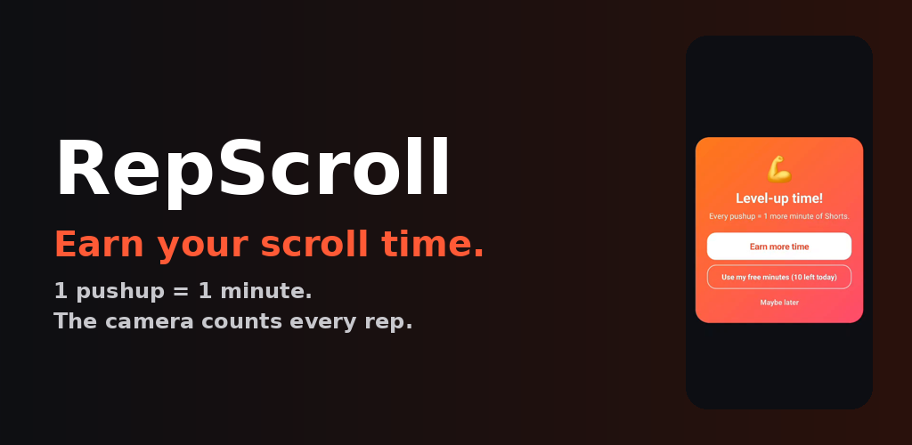
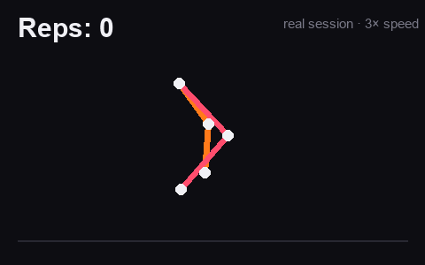
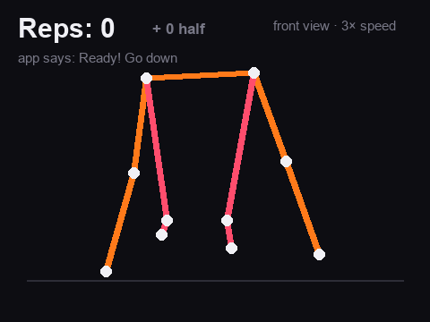
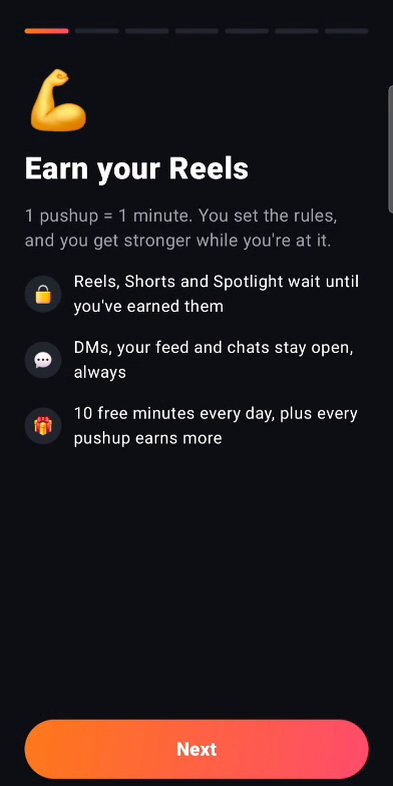
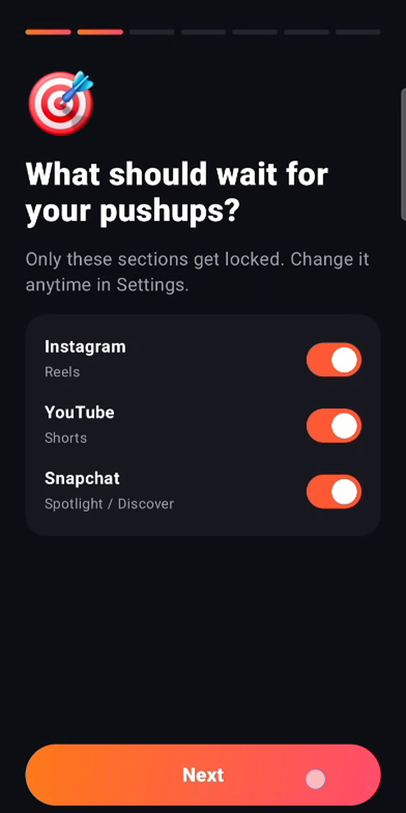
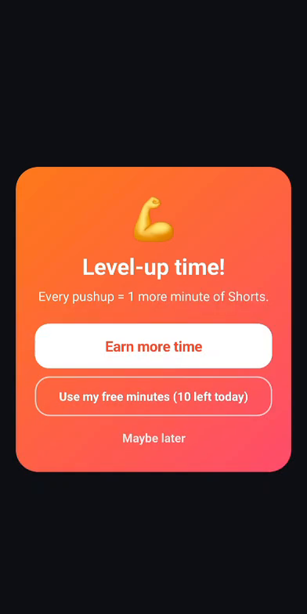
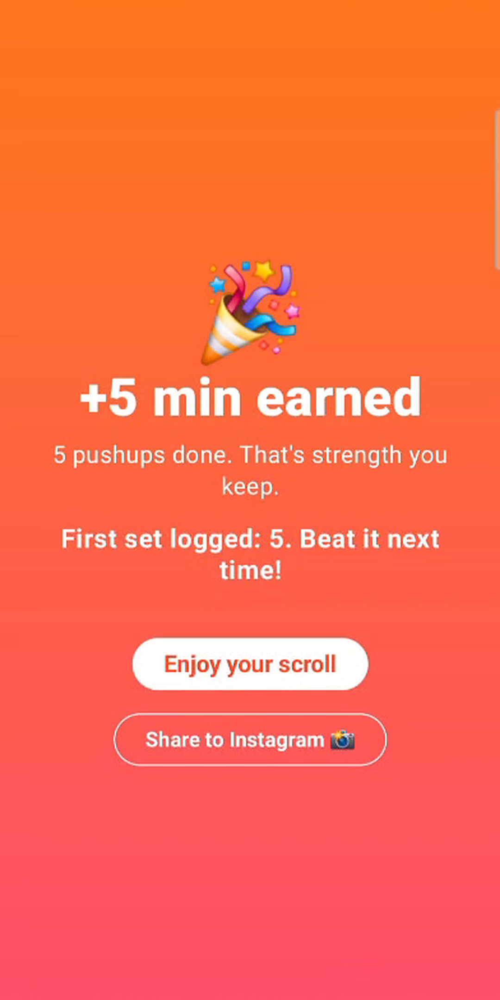
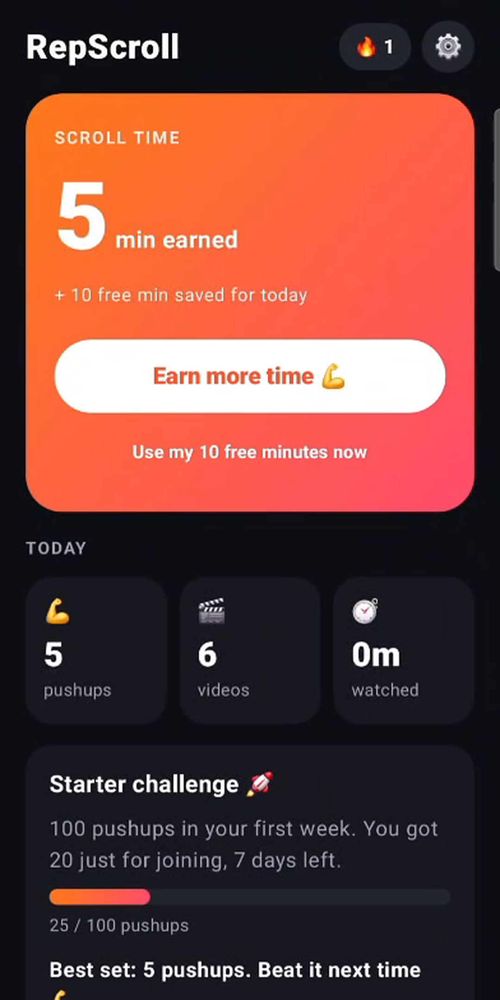
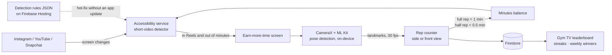

<p align="center"></p>

# RepScroll: earn your Reels with pushups

**The problem:** people lose hours a day to Reels and Shorts, and blocking apps get uninstalled because
they feel like punishment. Gyms, meanwhile, struggle to keep members engaged between visits.

**The solution:** an Android app that turns scrolling into a reward. Short-video sections (Instagram
Reels, YouTube Shorts, Snapchat Spotlight) wait until you've earned them, and **1 pushup = 1 minute**,
verified by the phone camera. Feed, DMs and chats are never touched. Gyms get a leaderboard on their TV,
weekly winners and streaks that bring members back.

**Status:** in a pilot with a local gym · v0.9.6 · built and shipped solo.

> This is a **showcase repo**. The full app is private because it's a commercial product. What's here is
> the core of it: the **pose-based pushup counter**, its tests, and the real recorded sessions it's tuned on.
> You can run them yourself (see [Run the tests](#run-the-tests)).

---

## See it work

Two **real recorded sessions** (pose landmarks from a phone camera) replayed through the counters:

| Side view | Front view |
|---|---|
|  |  |
| 2 full, 4 knee and 1 more full pushup. Halfway through, the person sits back on their heels instead of pushing up, and **that earns nothing**. Every rep lands within 0.5 s of when it really happened. | Phone on the floor facing the person: 10 full pushups and **one too shallow, which gets half credit**. The text is the app's real on-screen coaching at each moment. |

Both are asserted in [`PushupReplayTest`](src/test/kotlin/com/repscroll/app/pushup/PushupReplayTest.kt).
The front-view GIF is drawn from the counter's own frame-by-frame output.

| Setup | Choose what waits | Earn time | Celebrate | Home |
|---|---|---|---|---|
|  |  |  |  |  |

---

## How it works



### The hard part: counting pushups honestly

Counting "arm bent, arm straight" is easy. Making it **fair** is the real problem: people bow, sit back,
bend only their arms, or bounce. The counter ([`PushupCounter.kt`](src/main/kotlin/com/repscroll/app/pushup/PushupCounter.kt),
[`FrontPushupCounter.kt`](src/main/kotlin/com/repscroll/app/pushup/FrontPushupCounter.kt)) is a small state
machine over pose landmarks:

| Rule | Why |
|---|---|
| Body must be in a plank (shoulder-hip-knee line near horizontal) | Arm bends while standing or sitting earn nothing |
| Shoulders must actually drop ≥ 30% of torso length | Bending only the elbows isn't a pushup |
| Torso shrinking below 65% of its length = resting | Sitting back on the heels can't finish a rep |
| Front view: hips and knees must sit above the hands | A tester earned minutes by bowing while seated; this closed it |
| Minimum 600 ms per rep, 6-frame bad-form window | Rejects jitter and bouncing without punishing one glitchy frame |
| Half depth or sagging hips = **half credit** | Strict but encouraging: effort is never worth zero |
| Average the left and right sides, smooth with an EMA | ML Kit reports the hidden side confidently; picking one side made the shoulder jump |
| Side **and** front camera views, each with its own counter | From the front, elbow angles are foreshortened, so it uses shoulder height over hands ÷ shoulder width (independent of distance) |

Every threshold was **measured on real recordings**, not guessed. The comments in the code note the
numbers (for example, *"real front pushups −0.45 median, seated bow +0.23"*).

### Other engineering problems solved in the full app
- **Phones that kill background apps:** Vivo's power manager force-stopped the app 2–4 minutes into Reels.
  Found the cause (`com.vivo.abe`), added a guided fix in setup, and cut detection cost from 5.5% to ~3.4% of
  a CPU core. Verified with 30+ minutes of continuous use.
- **Instagram changes its layout:** detection rules are served as versioned JSON from Firebase Hosting,
  unit-tested against real captured screens, and picked up by phones within hours, with no app update.
- **Two release channels from one codebase:** a `play` flavor (in-app updates, review prompt) and a `pilot`
  flavor (Firebase App Distribution).
- **Retention by design, built from behaviour research:** a Monday fresh start, saved rest days for streaks,
  "N pushups to pass <name>" instead of a discouraging full ranking, and a 7-day starter challenge.

---

## Run the tests

Needs JDK 17+. No Android SDK required.

```bash
./gradlew test
```

26 tests: synthetic poses (full, knee and half reps, sagging hips, noise, tracking loss, cheating) plus
**4 replays of real recorded sessions**:

| Recording | Expected |
|---|---|
| `side_3full_4knee.csv`: side view, mixed full and knee pushups, sits back once | 7 reps, at the right moments |
| `front_10full_1half.csv`: front view | 10 full + 1 half |
| `front_cheat_seated_bow.csv`: seated, bowing to fake reps | **0** |
| `front_stuck_glitch.csv`: one glitched frame mid-set | counter doesn't freeze |

The full app has 73 tests, including short-video detection checked against real captured app screens.

## Tech

Kotlin · Jetpack Compose · CameraX · ML Kit Pose Detection · Accessibility services · WorkManager ·
Jetpack Glance widgets · Firebase (Auth, Firestore + rules tests, Hosting, Crashlytics, App Distribution)

---

© Hemanth Reddy. Source is shared for portfolio review only; all rights reserved.
